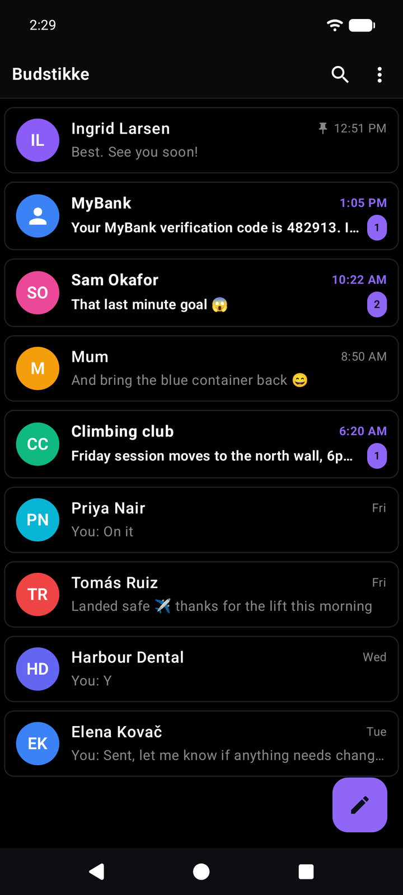
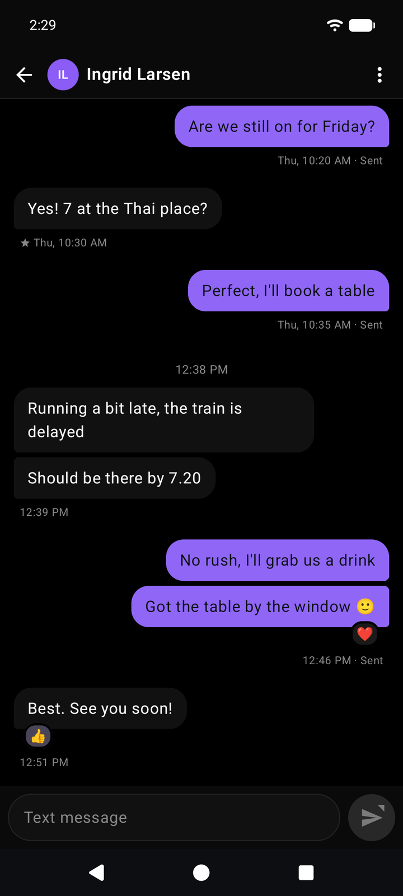
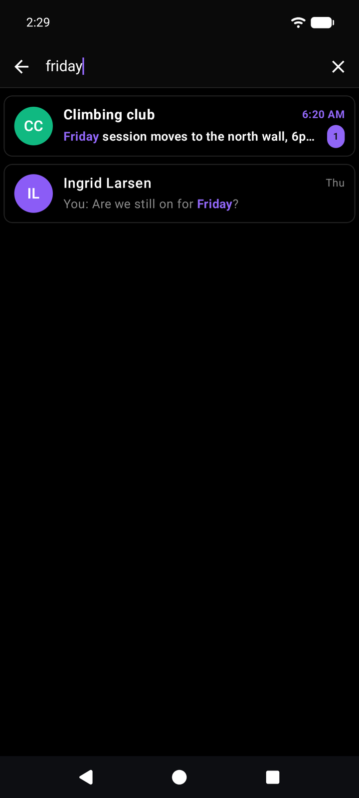
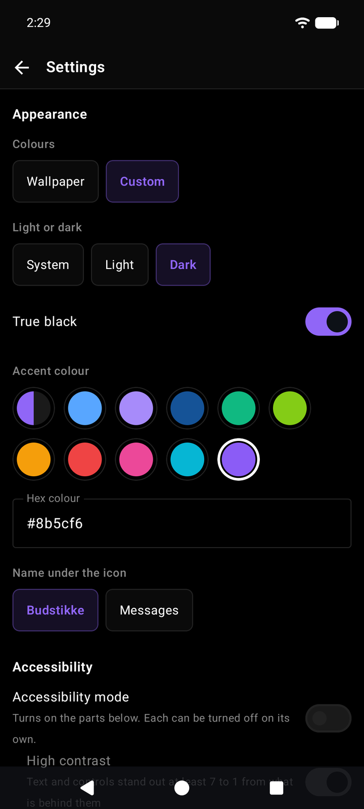

# Budstikke

[](https://github.com/AalmanSadath/Budstikke/actions/workflows/ci.yml)

An SMS app for Android that keeps your messages on your phone.

Budstikke replaces your default SMS app. It has no internet permission, so Android blocks it
from reaching the network: your messages never leave the device through the app, and nothing
goes through Google.

<p>
  <a href="docs/screenshots/list.png"></a>
  <a href="docs/screenshots/conversation.png"></a>
  <a href="docs/screenshots/search.png"></a>
  <a href="docs/screenshots/settings.png"></a>
</p>

## Features

### Messaging
- Send and receive SMS, with a choice of SIM on phones with more than one. An optional badge
  shows which SIM each conversation uses.
- Reply straight from the notification.
- Drafts are saved as you type and come back when you open the conversation.
- Schedule a message: long-press send to pick a date and time.
- Set a send delay, so a message can be cancelled in the seconds before it goes out.
- React to messages with an emoji. Reactions from Google Messages and iPhones show on the
  message they react to instead of as separate texts.
- Star messages to find them later, and copy or forward them.

### Privacy
- No internet permission, so the app cannot send your messages anywhere.
- Lock a conversation or single messages behind your screen lock. Locked text stays hidden in
  the list, in notifications and in search.
- One-time codes are underlined, and a tap copies them. A notification with a code offers a
  Copy code button.
- Block numbers.

### Organising
- Pin, archive and delete conversations. Deleted ones wait in a trash that empties itself
  after 30 days.
- Search conversations and messages.
- Contacts from your work profile show up in search and New message, marked with a briefcase.

### Backup and import
- Back up all your messages to a file anywhere the file picker reaches, including SD cards
  and cloud folders. The file is encrypted with a PIN you choose.
- Restore a backup on the same phone or a new one.
- Import messages from SMS Import / Export and QKSMS backups.

### Look and accessibility
- Colours from your wallpaper, or Budstikke's own dark, light and true black themes, with an
  accent colour of your choice.
- Accessibility mode: high contrast, larger text, larger touch targets and reduced motion,
  each of which can be turned off on its own, and descriptions for TalkBack.
- Choose whether the name under the icon is Budstikke or Messages.

### Not yet
- MMS: picture and group messages can't be sent, and existing ones are not shown.

## Install

Budstikke needs Android 10 or newer.

### With Obtainium

[Obtainium](https://github.com/ImranR98/Obtainium) installs apps from their GitHub releases
and tells you when a new one is out.

1. In Obtainium, tap **Add app**.
2. Paste `https://github.com/AalmanSadath/Budstikke` as the source URL and tap **Add**.
3. Tap **Install**.

### By hand

Download `Budstikke-X.Y.Z.apk` from the
[latest release](https://github.com/AalmanSadath/Budstikke/releases/latest), open it on your
phone and allow the install when Android asks.

### Check the download

Every release is signed with the same certificate. Its SHA-256 fingerprint is:

```
1B:99:20:19:C4:46:14:9B:E2:3A:89:69:2A:A4:C2:22:8A:76:77:38:3D:E1:84:ED:87:BB:E9:A0:A6:90:AE:CE
```

Apps such as [AppVerifier](https://github.com/soupslurpr/AppVerifier) compare an installed app
against it. If Android ever refuses an update because the signature differs, do not uninstall to get
around it: that APK was not signed by Budstikke.

Each release lists the APK's SHA-256 next to it, in `Budstikke-X.Y.Z.apk.sha256`. The release
workflow also signs a record of which commit and build produced the APK. With the GitHub CLI:

```
gh attestation verify Budstikke-X.Y.Z.apk --repo AalmanSadath/Budstikke
```

## License

GPL-3.0. See [LICENSE](LICENSE).
